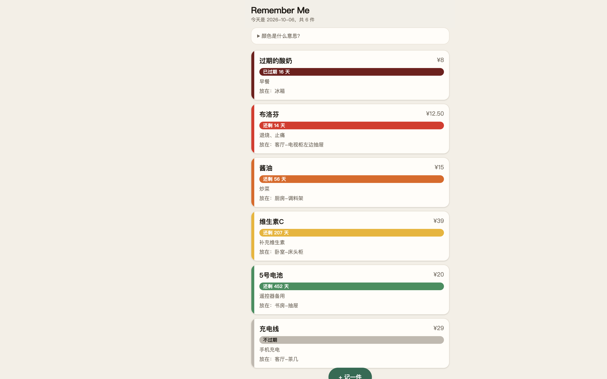
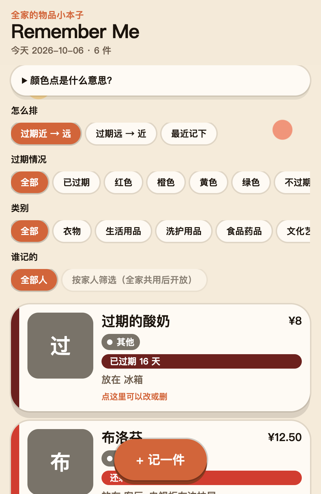

# Remember Me 开发日志

Remember Me 是一个全家一起用的物品小本子：买了什么、花了多少钱、有什么用、放在哪、还有多久过期，一眼就能看到。下面按时间顺序记录它从无到有、一步步迭代的过程。

---

## 2026-10-05 v0 最早的单机原型「记得住」

**做了什么**

最开始做的是一个叫「记得住」的单页网页，不用安装，打开就能看。顶部有三个入口：账本、位置、状态墙，右上角留了「记一笔」按钮，页脚留了导出和导入备份。三个页面当时还是空的说明文字，数据只存在当前浏览器里。

原型的代码和当时的记录保存在 `archive/v0-prototype/`。

**为什么这么做**

当时把它当作个人的生活记录工具，所以选了最省事的做法：不用打包工具，不连服务器，断网也能打开。

**遇到的问题和解决方法**

原型本身做得比较顺。真正的问题是在后来想清楚需求时才暴露的（见下一条）。

**截图**

待补

**家人的反馈**

待收集

---

## 2026-10-05 v0.1 重新定位：从“我一个人用”到“全家一起用”

**做了什么**

- 把产品名定为 **Remember Me**，目标从“个人记录”改成“全家共享的物品清单”。
- 明确了每件物品要记的信息：名称、价格、功能/用途、购买日期、过期日期、放置位置、备注。
- 定下了过期颜色规则（剩余天数记为 d）：
  - d <= 30 天：红色
  - 30 < d < 180 天：橙色
  - 180 <= d < 365 天：黄色
  - d >= 365 天：绿色
  - 已经过期：深红色，并写明“已过期 X 天”
  - 同一个颜色档里，越接近过期，颜色越深
- 定下了技术方案：手机网页（可以添加到主屏幕，用起来像 App）+ Supabase 云端数据库（家人之间实时同步）。
- 把旧原型归档，建立了这份开发日志和作品集素材文档，并设置了一条规则：AI 每做完一步，就自动往这里追加记录。

**为什么这么做**

- **为什么要改成全家共享**：家里的东西往往是一个人买、另一个人用。如果只存在一个人的手机里，其他人还是不知道东西放在哪、什么时候过期。共享是这个工具真正的价值所在。
- **为什么做网页而不是 App 或小程序**：网页不用上架审核，iOS 和安卓都能用，把一个链接发给家人就能开始用；“添加到主屏幕”之后体验接近 App。
- **为什么选 Supabase**：它把登录、数据库、实时同步打包好了，免费额度对一个家庭来说绰绰有余，省掉了自己写服务器的成本。
- **为什么“每天更新”不用定时任务**：数据库里只存“过期日期”，每次打开时用“过期日期 - 今天”现算剩余天数。这样数字天然就是当天的，不会出现“忘了更新”的情况，也不需要额外的服务器任务。
- **为什么颜色要分深浅**：只分四档的话，同样是红色，剩 2 天和剩 28 天看起来一样急。加上深浅之后，最急的东西最显眼。
- **为什么要单独加“已过期”状态**：最初的四档规则没有覆盖“已经过期”的情况，但这恰恰是最需要处理的东西，所以补了这一档。

**遇到的问题和解决方法**

开始动手前发现文件夹里已经有一版早期原型，方向和新定位不一致（单机 vs 共享）。处理方式是不删除，而是归档到 `archive/v0-prototype/`，把它作为项目演进的起点写进日志。

**截图**

待补

**家人的反馈**

待收集

---

## 2026-10-06 v0.2 先在一台设备上把清单做出来

**做了什么**

现在可以在网页里记下家里的东西了：名称、价格、功能、购买日期、过期日期、放在哪、备注。清单按「谁最先过期」排在前面，用颜色告诉你急不急。点卡片可以改，也可以删。

过期日期只存一个日子，每次打开页面用「那天减去今天」算出还剩几天，所以数字会跟着日历走。如果暂时不会过期，日期可以不填，显示成灰色的「不过期」。

为了让录入更快，过期日期旁边加了一排按钮：从购买日起算 1 个月、3 个月、半年、1 年……点一下就填好。

数据暂时只存在你正在用的这台手机或电脑的浏览器里。刷新不会丢，换一台设备就看不到。

**为什么这么做**

- **为什么还不做全家共享**：先把「记东西、看颜色」这条主路径做顺。如果颜色分档看不清、字段太多填不下去，后面接云端也白做。
- **为什么按剩余天数排序，而不是按购买时间**：这个工具的核心问题是「什么该先处理」，不是「最近买了什么」。
- **为什么加保质期快捷按钮**：很多包装上写的是「保质期 24 个月」，而不是一个具体日期。让人自己算日历太容易放弃。

**遇到的问题和解决方法**

中间有一版代码，页面各部分的「接口」对不上（有的按默认方式导出，有的按名字导出），浏览器报错后整页空白。修好对接之后，清单就能正常显示了。

另外：双击 `index.html` 打不开这套新页面，需要在项目目录运行 `npm run dev`，用终端给出的地址访问。

**截图**

**家人的反馈**

待收集

---

## 2026-10-06 v0.3 按第一次试用意见改界面、加照片和筛选

**做了什么**

自己试用后觉得第一版界面太素、没有使用欲望，而且不容易发现「写错了可以改」。这一版把页面改得更活泼：字更大、卡片更厚、角落有色点，类别用不同颜色的小标签。每张卡片上写了「点这里可以改或删」，点进去就能改字段、删掉，也可以换照片。

记东西时可以选类别：衣物、生活用品、洗护用品、食品药品、文化艺术、宠物用品、其他。照片不是必填，用来拍外观或存放位置。清单上面可以按「过期近到远 / 远到近 / 最近记下」排序，也可以按过期情况和类别筛选。「按谁记的筛选」先摆在那里，等全家共用后再真正能用。

**为什么这么做**

- **为什么走活泼风而不是高级留白**：这是给全家用的，包括不爱盯着细字的人。大色块和类别色点比细线更容易产生「想点一下」的感觉。过期红橙黄绿仍然只表示紧急程度，类别用紫、蓝、青这些不会打架的颜色。
- **为什么多加「食品药品」**：原来说了「等」，而过期提醒最常发生在吃的和药上，单独一类比塞进生活用品更清楚。
- **为什么上传人现在不能选**：现在还没有「家里有哪些人」。乱做一个假名单会误导，所以筛选条先占位。

**遇到的问题和解决方法**

照片如果原图太大，浏览器会存不下。保存前会把图缩小再压一遍，尽量不影响「看清长什么样」。

**截图**

**家人的反馈**

第一次试用：界面太素；希望能改能删；希望有照片和类别；东西多了要能排序筛选；全家共用后要能选/筛上传人。

---

## 2026-10-06 v0.4 加上家里的赤柴，背景波点会慢慢漂

**做了什么**

标题旁边加了一只吐舌头的赤色柴犬卡通，因为家里就有一条赤柴。它大约每六秒会「考虑」要不要吐舌头，不是每次都吐，所以看起来没那么机械。背景波点加到七个，会慢慢漂；如果系统开了减少动态，波点和吐舌都会停住。

右上角有声音按钮。进门会尽量播放放在 `public/song.mp3` 的歌（自己写的歌）。很多手机不允许网页一打开就出声，所以如果没响，点一下页面或按钮就会开始。不想听可以静音，下次打开还记得你关过。

**为什么这么做**

这是给自己家用的本子，放上家里的狗比再换一套通用图标更有感情。音乐默认想唱，但必须留静音，晚上翻药时不该被吓到。

**遇到的问题和解决方法**

歌曲已经接上：把自家的《4am》放到了 `public/song.mp3`。进门尽量播放，右上角可静音。

**截图**

待补

**家人的反馈**

待收集

---

## 2026-10-06 v0.4.1 小六换脸、波点退到后面、标题改圆字体

**做了什么**

第一版手画柴犬被吐槽太丑、不像小六，换成更可爱的赤柴头像，还是会按概率吐舌头。背景波点挪到最底层，不再挡字和卡片。标题 Remember Me 换成圆润的 Fredoka 艺术字，橘红色，更软一点。

后来对照小六的真照片，又把毛色从鲜橙红改成浅棕黄 / 沙金色，奶油色的脸和眉心也更贴一点。

**为什么这么做**

吉祥物要像自家的狗，不像通用图标。装饰层不能抢信息层。

**遇到的问题和解决方法**

通用「赤柴」模板颜色太艳，拿照片对照后才发现小六其实是偏浅的棕黄。

**截图**

待补

**家人的反馈**

小六的颜色不是鲜橙红，是更浅的棕黄色。

---

## 2026-10-07 v0.5 换成腾讯云 CloudBase，先做家庭邀请码

**做了什么**

全家在国内，后端改成腾讯云 CloudBase。登录定为用户名+密码（不要微信营业执照，也不用短信额度）。登录后创建家庭或输入邀请码，清单云端同步。

**为什么这么做**

微信网站应用要执照；短信要钱还觉得不安全。用户名密码最适合家里几个人长期用。

**遇到的问题和解决方法**

腾讯云不允许网页端直接「只用户名+密码」注册（防刷号）。家里人少，就在控制台「用户管理」里手动添加账号，再在网页登录。页面上仍留注册入口，能成更好，不成会提示去控制台。

体验版没有文档型数据库，只有 PostgreSQL，所以物品/家庭数据改成走 SQL（`app.rdb()`）。建表脚本在 `cloudbase/schema.sql`，在控制台 SQL 编辑器里执行即可。配置见 `docs/CLOUDBASE.md`。

**截图**

待补

**家人的反馈**

待收集

---

## 2026-10-07 澄清：本地开发多半不用手加安全域名

**做了什么**

配置清单里改成：本地 `localhost` 一般已默认放行；找不到「安全配置」入口可以先跳过，只有登录时报跨域/非法来源再去「安全来源」里加域名（必要时带端口 `localhost:5173`）。

**为什么这么做**

控制台界面和旧文档对不上，容易卡在「找不到环境配置」。豆包说「PG 模式完全不用安全域名」不完全对——网页仍走 CloudBase JS SDK，白名单机制还在；但官方默认已带 `localhost`，所以本地试用通常不用先配这一步。

**遇到的问题和解决方法**

这一步比较顺。

**截图**

待补

**家人的反馈**

待收集

---

## 2026-10-07 登录页去掉注册

**做了什么**

登录页只保留用户名+密码登录，去掉「注册」切换。新家人账号继续在 CloudBase 控制台「用户管理」里建。

**为什么这么做**

腾讯云开了「用户名密码登录」也不等于允许网页自助注册（防刷号）。注册按钮点了多半失败，家人会懵，不如干脆不显示。

**遇到的问题和解决方法**

这一步比较顺。

**截图**

待补

**家人的反馈**

待收集

---

## 2026-10-07 v0.7 加上 PWA，准备发给家人

**做了什么**

接上可安装的网页应用（PWA）：可以加到手机主屏幕、有小六图标、后台会自动更新。大文件歌曲不预先塞进缓存，免得第一次打开太慢。部署步骤写进 `docs/CLOUDBASE.md`（Vercel；国内慢可用 CloudBase 静态托管）。

**为什么这么做**

家人不需要上应用商店。上线后要把正式域名加进 CloudBase 安全来源，登录才会通。

**遇到的问题和解决方法**

本机没有登录 Vercel CLI，所以部署要你在网页上点几下完成（Import 仓库 → 填环境变量 → 上线）。

**截图**

待补

**家人的反馈**

待收集

---

## 2026-10-07 登录时提示本机用过的用户名

**做了什么**

本机成功登录过的用户名会记下来。下次输入前几个字母（比如 `adm`），下面会出现完整用户名（比如 `administrator`），点一下就填好，密码仍交给浏览器保存。

**为什么这么做**

家人共用几台设备时，少打字更省事；又不自己存密码，以后真要推广也更稳妥。

**遇到的问题和解决方法**

这一步比较顺。

**截图**

待补

**家人的反馈**

待收集

---

## 2026-10-08 线上登录 Load failed：要加 Vercel 域名白名单

**做了什么**

Vercel 已上线，但登录报 `Load failed` / `Failed to fetch`。查下来是 CloudBase 网关拒绝了来自 `rememberme-chi.vercel.app` 的请求（带这个 Origin 返回 403）。文档改为强调：线上域名必须加进「安全来源」；错误提示也改成大白话。

**为什么这么做**

有说法称「PG 模式不用安全域名」，对网页 JS SDK 登录并不成立。数据库可以靠 JWT+RLS，但登录请求本身仍会校验来源域名。

**遇到的问题和解决方法**

控制台菜单名可能叫「安全来源 / 安全域名」。直达链接写在 `docs/CLOUDBASE.md`。加完等几分钟再试。

**截图**

待补

**家人的反馈**

待收集

---

## 2026-10-08 v0.8 前端改到 CloudBase 静态托管

**做了什么**

上线方式从 Vercel 改成 CloudBase「静态网站托管」。文档改成控制台上传 `dist/`（或 zip）的步骤；加了 `npm run pack:hosting` 方便打包。Vercel 只当备份。

**为什么这么做**

Vercel 国内访问不稳；给 Vercel 域名加跨域白名单还可能要买套餐。前端和数据都放腾讯云，默认托管域名通常已放行，家人打开也更顺。

**遇到的问题和解决方法**

部署仍需你在控制台点上传（或本机 `tcb login` 后 `npm run deploy:hosting`）。上传后把「404 / 错误页」设成 `index.html`。

**截图**

待补

**家人的反馈**

待收集

---

## 2026-10-08 v0.9 手机优先的温馨 UI

**做了什么**

按 `warm-theme-web-design` skill 只改界面：更柔的米白/陶土橙配色、更大触控区、软阴影。音乐控件挪到左下角；「保存」改到底部主按钮条，避免再挡住。登录/列表/表单/家庭页都按窄屏重排了一遍。

**为什么这么做**

男朋友在手机上试，发现音乐按钮挡住了保存。电脑上看不出来。功能步骤不变，只让手机更好用。

**遇到的问题和解决方法**

表单顶部「保存」和音乐都在右上角会打架，所以保存下沉、音乐靠左下，中间留给「记一件」。

**截图**

待补

**家人的反馈**

待收集

---

## 2026-10-09 v0.9.1 音乐键可拖、贴边半藏，配色再收一轮

**做了什么**

音乐控件改成可拖动的 🎵 小圆钮（淡黄油色），松手靠近屏幕边会自动贴边，只露出大约一半，播放中也能贴边。主色点缀改成蜜桃陶土（约 `#DD9F6B`），正文墨色略加深；背景彩色波点恢复。代码已推到旧仓库 `rememberme`。

**为什么这么做**

固定左下角仍可能挡操作；可拖 + 贴边半藏，需要时再拽出来。蜜桃陶土比偏灰的陶土更亮一点，手机上字和按钮更好认。

**遇到的问题和解决方法**

这一步比较顺。开发日志之前只写到「挪到左下角」，和现状不一致，本条补上。

**截图**

待补

**家人的反馈**

待收集

---

## 2026-10-09 默认域名打开会下载页面：腾讯云风控，不是包坏了

**做了什么**

查了线上地址的响应头：页面文件是对的，但带了 `Content-Disposition: attachment`，所以浏览器下载 `index.html`。浏览器正常访问时还会先出「风险提醒」中间页。已写进 `docs/CLOUDBASE.md`。

**为什么这么做**

家人要用默认域名打开；误以为是上传方式错了，其实是平台对未备案默认域名的限制。

**遇到的问题和解决方法**

重传 zip 解决不了。短期：用系统浏览器打开，过风险提示。长期：绑已备案自定义域名。

**截图**

待补

**家人的反馈**

待收集

---

## 2026-10-27 v0.10 一人可进多家 + 清单关键词搜索

**做了什么**

一个人可以加入多个家：只有一家时登录直接进清单；有多家时先选家。清单顶常显示「当前：××家」，点开可切换、新建或用邀请码再加一家。「退出登录」和「换家」分开。清单加了搜索框，按名称、位置、备注、说明即时过滤，可和原来的过期/类别筛选一起用。

**为什么这么做**

自己试用后发现：以后去别处住会需要新家，但旧家物品还要能看；物品多了单靠分类不好找。数据库本来就允许多家成员，以前是前端只认第一家。

**遇到的问题和解决方法**

这一步比较顺。没改数据库表结构。

**截图**

待补

**家人的反馈**

待收集

---

## 2026-11-03 自定义域名备案已提交（等待审核）

**做了什么**

买了域名 `remembermezz.xyz` 并完成实名；`remember-me` 升到个人版并续到足够时长；开通云托管固定公网 IP；用云开发环境作为备案云资源，提交了个人 ICP 备案（不走企业才有的备案授权码）。

**为什么这么做**

默认域名有风控（下载页 / 风险提醒），家人长期用需要已备案自定义域名。个人账号不能生成备案授权码，优先用已付费的云开发环境备案，避免再单独买轻量服务器。

**遇到的问题和解决方法**

备案页曾误以为必须买轻量 / 用授权码；其实个人可选「云开发」，前提是个人版 + 剩余有效期 ≥6 个月 + 固定 IP。固定 IP 需在云托管服务设置里手动开启。

**截图**

待补

**家人的反馈**

待收集

---

## 2026-10-29 默认域名「下载网页 / 风险提醒」问题整理

**做了什么**

把线上默认域名打不开（变成下载 `index.html`、或先出风险页）这件事整理清楚，写进开发日志和作品集素材，方便面试时讲「踩过什么坑、怎么取舍」。

**问题是什么**

用 CloudBase 默认域名打开站点时（例如 `….webapps.tcloudbase.com`）：

- 有时浏览器直接**下载** `index.html`，不像在打开网站
- 有时先出现腾讯云「**风险提醒**」中间页，点「确定访问」后才能进站

查过响应头：页面内容和打包产物是对的，但平台加了 `Content-Disposition: attachment`，浏览器就会当附件下载。

**为什么会出现**

腾讯云对**未备案的默认域名**有安全合规策略（官方文档：默认域名访问限制及中间页）：

- 系统浏览器正常打开（页面跳转）：可能先出风险提醒；确认后靠 Cookie 暂时记住
- 微信内置浏览器、部分 App 内打开、或非页面跳转请求：容易带上「强制下载」头
- 所以会出现：手机 Safari 能用、电脑下载；或手机以前能用，换入口 / Cookie 过期后又变下载
- **重传 zip、重新部署解决不了**——不是包坏了，是域名策略

**临时解决方案（家人小范围试用）**

1. 用 Safari / Chrome 打开，不要从微信里直接点链接
2. 在地址栏手动粘贴完整网址
3. 出现风险提醒时点「确定访问」
4. 尽量固定同一浏览器；清缓存或换设备后可能要再确认一次

**根本解决方案**

绑定**已完成 ICP 备案的自定义域名**，在静态托管 / HTTP 访问里配好解析和 HTTPS。自定义域名不受这套默认域名风控限制；上线后把新域名加进「安全来源」，再把新链接发给家人。

**截图**

待补

**家人的反馈**

待收集

---

## 2026-10-29 补充：和机型无关；作品集改成诚实说明；域名申请中

**做了什么**

用自己的使用记录把原因说得更准：电脑前几次能开、后来一直下载；手机突然下载，删掉主屏幕快捷方式、浏览器重输网址后又好。对照官方文档：只有正经页面跳转才出风险页并靠 Cookie 放行，Cookie 过期或快捷方式等入口容易直接下载。作品集去掉「请优先用手机」，写进排查过程，并注明正在申请备案域名。

**为什么这么做**

「手机可以、电脑不行」会误导试用的人；也容易误判成部署坏了。

**遇到的问题和解决方法**

短期把试用说明写清楚；根本解法仍是自定义备案域名（申请中）。重传 zip 无效。

**截图**

无

**家人的反馈**

待收集

## 2026-11-11 绑定自定义域名 remembermezz.xyz（等 DNS）

**做了什么**

备案通过的域名 `remembermezz.xyz` 绑到了云开发：免费 SSL（证书 ID `cHukFuoG`）、安全来源已加、根路径指向静态托管里的应用目录。还差一步：在 DNS 里加 CNAME，指向平台给的地址后，家人才能用 `https://remembermezz.xyz` 打开，不再走会下载网页的默认域名。

**为什么这么做**

默认域名有「下载 / 风险提醒」风控，重传包无效。自定义已备案域名才是给家人长期用的入口。

**遇到的问题和解决方法**

AI 侧不能代写 DNS / 代申请证书（角色权限不够），所以证书和归属 TXT 由人工在控制台完成；绑域名、建路由、路径改写到 `remember-me/` 目录由平台接口完成。根域名 CNAME 加好后才能验收登录。

**截图**

待补

**家人的反馈**

待收集

## 2026-11-11 自定义域名验收通过

**做了什么**

CNAME 生效后，手机和电脑都能用 `https://remembermezz.xyz` 正常打开、登录使用。平台侧 DNS 状态已是 OK；HTTPS 返回正常网页（`text/html`），不再出现默认域名那种强制下载。

**为什么这么做**

确认「备案域名 + SSL + 安全来源 + 网关路由」这条正式入口真的能给家人用，默认域名风控问题可以从产品叙事里标成已解决。

**遇到的问题和解决方法**

这一步比较顺；前面卡的是证书申请与 DNS 手写，验收本身没有再踩坑。

**截图**

待补

**家人的反馈**

本人手机、电脑均正常打开使用；家人侧待收集。

## 2026-11-14 v0.11 家庭可以改名，退出前要确认

**做了什么**

已经加入的家庭可以改名字，但清单卡片上不再放「改名字」。改名字在「切换家庭」里：每一家右边是「编辑」和「删除」。点「编辑」后直接改这一行的名字，输入框最右边有「保存」，点它、离开输入框或按完成都会保存。点「删除」会先问要不要退出，确认后才把自己移出这家，不马上退出，也不删别人的东西。切换抽屉里没有整行的「退出这个家」。新建家庭时，名字框不再事先写上「我们家」，不填就不能创建。退出后如果还剩一家，就自动进去；还剩多家，就回到选家；一家都不剩，就回到创建或加入。

**为什么这么做**

创建时输入框里预先写着「我们家」，不改就会存成这个名字，建完又找不到地方改。退出如果一点就生效，很容易误触，所以先弹出确认，并且把「先留着」做成主按钮。退出只拿掉自己的成员身份，不删这一家的物品，避免一个人离开就把全家的记录清掉。

**遇到的问题和解决方法**

每一家旁边的「删除」听起来像把东西删掉。实际只是自己离开，所以点下去先弹出「要退出吗」，确认后才移出这家。清单卡片只保留名字和邀请码，不再放「改名字」。

**截图**

待补

**家人的反馈**

待收集
