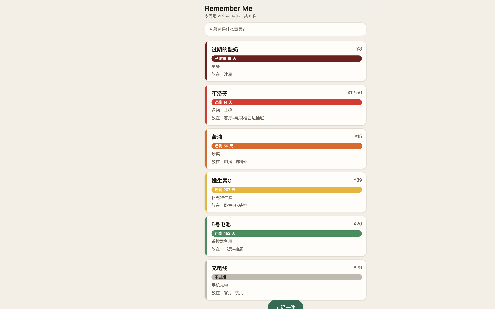
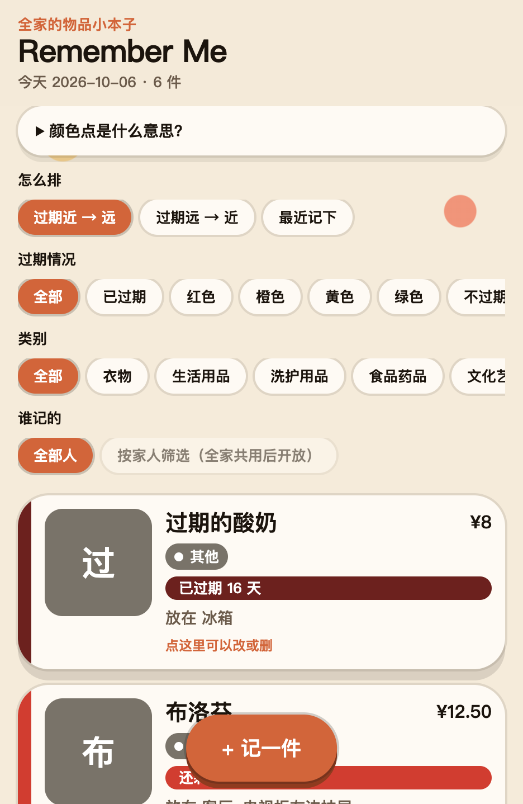

# Remember Me 开发日志

Remember Me 是一个全家一起用的物品小本子：买了什么、花了多少钱、有什么用、放在哪、还有多久过期，一眼就能看到。下面按时间顺序记录它从无到有、一步步迭代的过程。

---

## 2026-10-05 v0 最早的单机原型「记得住」

**做了什么**

最开始做的是一个叫「记得住」的单页网页，不用安装，打开就能看。顶部有三个入口：账本、位置、状态墙，右上角留了「记一笔」按钮，页脚留了导出和导入备份。三个页面当时还是空的说明文字，数据只存在当前浏览器里。

原型的代码和当时的记录保存在 `archive/v0-prototype/`。

**为什么这么做**

当时把它当作个人的生活记录工具，所以选了最省事的做法：不用打包工具，不连服务器，断网也能打开。

**遇到的问题和解决方法**

原型本身做得比较顺。真正的问题是在后来想清楚需求时才暴露的（见下一条）。

**截图**

待补

**家人的反馈**

待收集

---

## 2026-10-05 v0.1 重新定位：从“我一个人用”到“全家一起用”

**做了什么**

- 把产品名定为 **Remember Me**，目标从“个人记录”改成“全家共享的物品清单”。
- 明确了每件物品要记的信息：名称、价格、功能/用途、购买日期、过期日期、放置位置、备注。
- 定下了过期颜色规则（剩余天数记为 d）：
  - d <= 30 天：红色
  - 30 < d < 180 天：橙色
  - 180 <= d < 365 天：黄色
  - d >= 365 天：绿色
  - 已经过期：深红色，并写明“已过期 X 天”
  - 同一个颜色档里，越接近过期，颜色越深
- 定下了技术方案：手机网页（可以添加到主屏幕，用起来像 App）+ Supabase 云端数据库（家人之间实时同步）。
- 把旧原型归档，建立了这份开发日志和作品集素材文档，并设置了一条规则：AI 每做完一步，就自动往这里追加记录。

**为什么这么做**

- **为什么要改成全家共享**：家里的东西往往是一个人买、另一个人用。如果只存在一个人的手机里，其他人还是不知道东西放在哪、什么时候过期。共享是这个工具真正的价值所在。
- **为什么做网页而不是 App 或小程序**：网页不用上架审核，iOS 和安卓都能用，把一个链接发给家人就能开始用；“添加到主屏幕”之后体验接近 App。
- **为什么选 Supabase**：它把登录、数据库、实时同步打包好了，免费额度对一个家庭来说绰绰有余，省掉了自己写服务器的成本。
- **为什么“每天更新”不用定时任务**：数据库里只存“过期日期”，每次打开时用“过期日期 - 今天”现算剩余天数。这样数字天然就是当天的，不会出现“忘了更新”的情况，也不需要额外的服务器任务。
- **为什么颜色要分深浅**：只分四档的话，同样是红色，剩 2 天和剩 28 天看起来一样急。加上深浅之后，最急的东西最显眼。
- **为什么要单独加“已过期”状态**：最初的四档规则没有覆盖“已经过期”的情况，但这恰恰是最需要处理的东西，所以补了这一档。

**遇到的问题和解决方法**

开始动手前发现文件夹里已经有一版早期原型，方向和新定位不一致（单机 vs 共享）。处理方式是不删除，而是归档到 `archive/v0-prototype/`，把它作为项目演进的起点写进日志。

**截图**

待补

**家人的反馈**

待收集

---

## 2026-10-06 v0.2 先在一台设备上把清单做出来

**做了什么**

现在可以在网页里记下家里的东西了：名称、价格、功能、购买日期、过期日期、放在哪、备注。清单按「谁最先过期」排在前面，用颜色告诉你急不急。点卡片可以改，也可以删。

过期日期只存一个日子，每次打开页面用「那天减去今天」算出还剩几天，所以数字会跟着日历走。如果暂时不会过期，日期可以不填，显示成灰色的「不过期」。

为了让录入更快，过期日期旁边加了一排按钮：从购买日起算 1 个月、3 个月、半年、1 年……点一下就填好。

数据暂时只存在你正在用的这台手机或电脑的浏览器里。刷新不会丢，换一台设备就看不到。

**为什么这么做**

- **为什么还不做全家共享**：先把「记东西、看颜色」这条主路径做顺。如果颜色分档看不清、字段太多填不下去，后面接云端也白做。
- **为什么按剩余天数排序，而不是按购买时间**：这个工具的核心问题是「什么该先处理」，不是「最近买了什么」。
- **为什么加保质期快捷按钮**：很多包装上写的是「保质期 24 个月」，而不是一个具体日期。让人自己算日历太容易放弃。

**遇到的问题和解决方法**

中间有一版代码，页面各部分的「接口」对不上（有的按默认方式导出，有的按名字导出），浏览器报错后整页空白。修好对接之后，清单就能正常显示了。

另外：双击 `index.html` 打不开这套新页面，需要在项目目录运行 `npm run dev`，用终端给出的地址访问。

**截图**

**家人的反馈**

待收集

---

## 2026-10-06 v0.3 按第一次试用意见改界面、加照片和筛选

**做了什么**

自己试用后觉得第一版界面太素、没有使用欲望，而且不容易发现「写错了可以改」。这一版把页面改得更活泼：字更大、卡片更厚、角落有色点，类别用不同颜色的小标签。每张卡片上写了「点这里可以改或删」，点进去就能改字段、删掉，也可以换照片。

记东西时可以选类别：衣物、生活用品、洗护用品、食品药品、文化艺术、宠物用品、其他。照片不是必填，用来拍外观或存放位置。清单上面可以按「过期近到远 / 远到近 / 最近记下」排序，也可以按过期情况和类别筛选。「按谁记的筛选」先摆在那里，等全家共用后再真正能用。

**为什么这么做**

- **为什么走活泼风而不是高级留白**：这是给全家用的，包括不爱盯着细字的人。大色块和类别色点比细线更容易产生「想点一下」的感觉。过期红橙黄绿仍然只表示紧急程度，类别用紫、蓝、青这些不会打架的颜色。
- **为什么多加「食品药品」**：原来说了「等」，而过期提醒最常发生在吃的和药上，单独一类比塞进生活用品更清楚。
- **为什么上传人现在不能选**：现在还没有「家里有哪些人」。乱做一个假名单会误导，所以筛选条先占位。

**遇到的问题和解决方法**

照片如果原图太大，浏览器会存不下。保存前会把图缩小再压一遍，尽量不影响「看清长什么样」。

**截图**

**家人的反馈**

第一次试用：界面太素；希望能改能删；希望有照片和类别；东西多了要能排序筛选；全家共用后要能选/筛上传人。

---

## 2026-10-06 v0.4 加上家里的赤柴，背景波点会慢慢漂

**做了什么**

标题旁边加了一只吐舌头的赤色柴犬卡通，因为家里就有一条赤柴。它大约每六秒会「考虑」要不要吐舌头，不是每次都吐，所以看起来没那么机械。背景波点加到七个，会慢慢漂；如果系统开了减少动态，波点和吐舌都会停住。

右上角有声音按钮。进门会尽量播放放在 `public/song.mp3` 的歌（自己写的歌）。很多手机不允许网页一打开就出声，所以如果没响，点一下页面或按钮就会开始。不想听可以静音，下次打开还记得你关过。

**为什么这么做**

这是给自己家用的本子，放上家里的狗比再换一套通用图标更有感情。音乐默认想唱，但必须留静音，晚上翻药时不该被吓到。

**遇到的问题和解决方法**

歌曲已经接上：把自家的《4am》放到了 `public/song.mp3`。进门尽量播放，右上角可静音。

**截图**

待补

**家人的反馈**

待收集

---

## 2026-10-06 v0.4.1 小六换脸、波点退到后面、标题改圆字体

**做了什么**

第一版手画柴犬被吐槽太丑、不像小六，换成更可爱的赤柴头像，还是会按概率吐舌头。背景波点挪到最底层，不再挡字和卡片。标题 Remember Me 换成圆润的 Fredoka 艺术字，橘红色，更软一点。

后来对照小六的真照片，又把毛色从鲜橙红改成浅棕黄 / 沙金色，奶油色的脸和眉心也更贴一点。

**为什么这么做**

吉祥物要像自家的狗，不像通用图标。装饰层不能抢信息层。

**遇到的问题和解决方法**

通用「赤柴」模板颜色太艳，拿照片对照后才发现小六其实是偏浅的棕黄。

**截图**

待补

**家人的反馈**

小六的颜色不是鲜橙红，是更浅的棕黄色。

---

## 2026-10-07 v0.5 换成腾讯云 CloudBase，先做家庭邀请码

**做了什么**

全家在国内，Supabase 可能不稳定，后端改成腾讯云 CloudBase（上海，环境 ID 已配好）。现在可以：填称呼进入 → 创建家庭或输入邀请码加入 → 清单存到云端，家人看到同一份。微信扫码登录按钮留好了，等开放平台开通后再真正接通。临时也能选「只用本机」。

**为什么这么做**

国内访问 CloudBase 更稳。微信网站应用申请可能要资质认证，所以先用「称呼 + 匿名登录」把共享主流程跑通，不堵住试用。

**遇到的问题和解决方法**

要用云端前，必须在控制台：① 安全域名加上 `localhost`；② 打开匿名登录；③ 建好 `households` / `members` / `items` 三个集合。详细步骤写在 `docs/CLOUDBASE.md`。

**截图**

待补

**家人的反馈**

待收集
